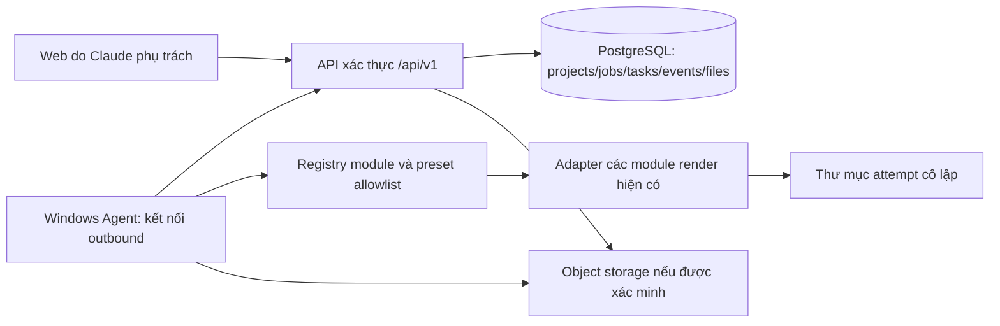

# Kiến trúc — DRAFT 0.1.0

Ngày 2026-10-22. Quyết định người dùng: PostgreSQL; không dùng SQLite cho backend/queue mới.
Phạm vi ưu tiên là tách module render trong Lay video tiktok. Xem RENDER_MODULE_INVENTORY.md.
Document revision 0.1.1-draft: CPU pilot đã có trong command_center/, PostgreSQL Docker riêng,
API local cổng 8016, Agent outbound one-shot. Đây vẫn là mục tiêu mở rộng cho các preset AI chưa tích hợp.
Xem COMMAND_CENTER_LOCAL.md và COMMAND_CENTER_TEST_REPORT.md để biết phần thực sự đã kiểm chứng.

Cập nhật 2026-10-22 (quyết định người dùng): PC chỉ gọi ra HTTPS cổng 443 và chờ nhận lệnh —
Agent chạy vòng lặp claim (`run_forever`, `--loop`), PC không mở cổng vào nào và không nhận
kết nối đẩy vào qua Tunnel. URL API từ xa bị khóa ở https cổng 443 (`OUTBOUND_443_ONLY`).
API/PostgreSQL production phải đặt ngoài PC; bản local cổng 8016 chỉ còn là môi trường dev.

## Trách nhiệm và stack

- Dùng Python/FastAPI và psycopg 3 cho API/Agent; venv tách biệt, không nâng model/Torch/CUDA.
  PostgreSQL Docker riêng tại loopback 55439 đã chạy và thử migration/restore.
- PostgreSQL là nguồn sự thật duy nhất của backend mới: không fallback RAM/SQLite khi DB lỗi.
  API readiness trả 503 và Agent không nhận job mới khi không xác minh được claim bền vững.
- Giữ renderer cũ qua facade; chọn đúng nhánh bằng registry và preset snapshot.
- Windows Agent không gọi nguyên Telegram handler; các connector thông báo/giao file là bước riêng.
- Cloudflare chỉ là lựa chọn ingress/hosting sau kiểm chứng Access/Tunnel/domain/quyền;
  không chọn D1 làm database, không giả định R2/Queues đã có. Trong mô hình outbound 443,
  ingress (nếu có) đặt tại máy chủ API ngoài PC, không trỏ vào PC.
- File lớn ở workspace hoặc object storage được duyệt. PostgreSQL lưu metadata/reference,
  không lưu bytes MP4/WAV trong job JSON hay cột dữ liệu video.

## Data model dự kiến

| Bảng PostgreSQL | Nội dung / ràng buộc chính |
|---|---|
| projects | id UUID, owner_id, name, archived_at, timestamps; owner kiểm tra mọi query |
| module_versions | Mục tiêu; pilot dùng registry versioned trong code, chưa có bảng này |
| preset_versions | Mục tiêu; pilot dùng registry versioned trong code, chưa có bảng này |
| jobs | UUID, project FK, status, manifest JSONB, version, cancel_requested, timestamps |
| tasks | UUID, job FK, task_key unique trong job, module version, status, attempt, lease token/deadline |
| task_dependencies | task FK + dependency FK cùng job; DAG kiểm tra trước tạo |
| attempts | task FK, attempt number unique, agent FK, fencing token, outcome |
| agents | principal, machine identity, capabilities, heartbeat, disabled_at |
| events | job/task FK, sequence, timestamp, structured safe payload; cursor theo sequence |
| files | UUID, project/job/task/attempt FK, logical kind, size, sha256, storage key, verification status |
| idempotency_keys | owner + method + route + key unique, request digest, resource/result, expiry |

Claim: transaction ngắn SELECT ... FOR UPDATE SKIP LOCKED trên task đủ dependency;
UPDATE status/agent/lease/attempt cùng transaction. Không giữ transaction qua render.
Agent completion cần đúng fencing token, agent, attempt và lease còn hiệu lực.
Lease hết hạn chuyển needs_attention nếu có thể còn tiến trình/tác dụng phụ; không replay mù.

## GPU và an toàn

Mặc định một GPU task mỗi máy. Một lease PostgreSQL theo machine/resource và một khóa OS chung
phải bao phủ cả worker mới lẫn entrypoint legacy được tích hợp; hiện chưa có bảo đảm này.
Không coi khóa theo từng file queue hay từng lock_dir là khóa toàn máy.
JSON không nhận executable, shell command, FFmpeg filter tùy ý hoặc đường dẫn tuyệt đối từ client.
Agent tự tạo argv từ module/action allowlist và resolve file ID vào root được cấu hình cục bộ.
Các task có chi phí API chỉ chạy khi config/model/reference và quyền đã xác thực.

## Migration và retention

SQLite còn trong code cũ chỉ là nguồn migration, không phải lựa chọn persistence cho hệ thống mới.
Kiểm kê cả wuby_queue.sqlite3 và database Autopilot trước quyết định phạm vi cutover;
không xóa database đăng bài ngoài phạm vi render. Chuyển jobs/config/review/output mapping sang PostgreSQL,
giữ legacy_id unique và dấu nguồn, không dịch needs_attention thành pending.
Staging import phải đối chiếu số lượng theo state, timestamps, config digest, file checksum và relationship.
Không tự chuyển job running; dừng/đối soát process trước cutover.
Backup PostgreSQL: pg_dump/pg_restore theo version server đã chọn; thử restore sang DB riêng trước nghiệm thu.
Retention DB/log/artifact và object lifecycle chưa chốt, không chạy prune tự động.
Đợt triển khai tiếp theo đã tạo container PostgreSQL dev riêng theo yêu cầu tiếp tục backend;
chưa tạo tài khoản cloud hoặc kết nối/cutover production. Không đổi database của stack Motion.
