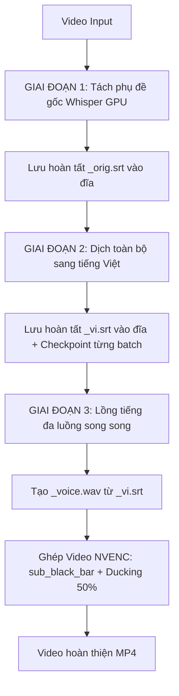

# 📦 HƯỚNG DẪN CHI TIẾT & KIẾN TRÚC CẤU HÌNH 3 (REVIEW PHIM NAM)

Gói mã nguồn này bao gồm toàn bộ mã nguồn xử lý của **Cấu hình 3** (Nam Review Phim - Thanh đen đáy chữ trắng - Audio Ducking 50% - Kiến trúc dịch 3 bước chuẩn `D:\02_CONG_CU\youtube-reup-pipeline`).

---

## 🎯 1. ĐẶC TẢ CẤU HÌNH 3 (SPECIFICATION)

| Tham số | Giá trị | Ý nghĩa | File cấu hình |
|---|---|---|---|
| **Voice** | `nam_minh` | Giọng đọc Microsoft Edge-TTS `vi-VN-NamMinhNeural` | `channels_config.json` |
| **Speed** | `1.4x` | Tốc độ phát âm nhanh, gãy gọn, hợp video review | `channels_config.json` |
| **Mask Mode** | `sub_black_bar` | **Chỉ vẽ 1 thanh đen mỏng** đè lên phụ đề Trung ở đáy màn hình. **KHÔNG** có 2 dải đen trên/dưới. Giữ trọn khung hình gốc. | `video_merger.py` |
| **Phụ đề** | Chữ trắng viền đen | `BorderStyle: 3` (hoặc `Outline: 4`), chữ màu trắng `#FFFFFF`, căn giữa lọt gọn trong thanh đen đáy. | `video_merger.py` |
| **Audio Ducking** | `bg_volume: 0.5` | Giảm âm lượng nhạc nền khi có thuyết minh; nhả về **50% nhạc nền gốc** ở các khoảng lặng tự nhiên giữa các câu thoại. | `video_merger.py` |
| **Kiến trúc dịch** | 3 Bước độc lập | 1. Whisper ra `_orig.srt` -> 2. DeepSeek ra `_vi.srt` -> 3. Lồng tiếng & Ghép video | `sub_processor.py` |

---

## 🏗️ 2. KIẾN TRÚC 3 GIAI ĐOẠN ĐỘC LẬP (CHUẨN YOUTUBE-REUP-PIPELINE)



### Chi tiết các file xử lý chính:

### 1. `backend/sub_processor.py`
- **`extract_and_transcribe_to_srt`**: Nhận diện Whisper, gộp âm tiết mồ côi tiếng Trung `merge_chinese_orphan_segments`, ghi file `_orig.srt`. Checkpoint resume nếu file đã có.
- **`OpenAISubtitleTranslator`**: Dịch từ `_orig.srt` sang `_vi.srt` bằng prompt `[ID] text` (miễn nhiễm lỗi JSON), lọc AI garbage `clean_ai_garbage`, quy đổi tiền tệ `convert_to_million_vnd` (vạn tệ, nghìn tệ -> triệu đồng, nghìn đồng). Lưu checkpoint `.partial.srt` mỗi 25 câu.
- **`generate_dubbed_audio`**: Tạo giọng lồng tiếng Edge-TTS đa luồng (6 workers song song với `asyncio.Semaphore(6)`), có persistent cache trong `tts_cache_{stem}` để không bao giờ phải tải lại các câu đã sinh.

### 2. `backend/video_merger.py`
- **Xử lý `sub_black_bar`**:
  - Dùng thuật toán OCR / box detection bắt toạ độ hộp phụ đề đáy tiếng Trung gốc (`sub_y`, `sub_h`).
  - Thêm filter `drawbox=x=0:y={box_y}:w=iw:h={box_h}:color=black@1:t=fill`.
  - Căn chỉnh vị trí ASS subtitle tiếng Việt với `MarginV` chuẩn xác để chữ tiếng Việt rơi vào đúng giữa thanh đen.
- **Xử lý Audio Ducking**:
  - Filter `sidechaincompress` hoặc `amix` kết hợp `volume` tạo hiệu ứng ducking 50%: khi giọng thuyết minh cất lên sẽ tự động ép nhạc nền xuống; khi hết câu thoại sẽ tự động mở lại 50% nhạc nền để video không bị câm lặng.

### 3. `backend/channels_config.json`
- Chứa toàn bộ khai báo cấu hình preset `cauhinh3`:
  ```json
  "cauhinh3": {
    "name": "Cấu hình 3 (Nam Review - Chữ trắng nền đen)",
    "workflow": "cauhinh3",
    "mask_mode": "sub_black_bar",
    "render_profile": "sub_black_bar",
    "voice": "nam_minh",
    "speed": 1.4,
    "bg_volume": 0.5,
    "vocal_cut": false,
    "keep_bg_audio": true,
    "show_title_card": false,
    "burn_sub": true,
    "drive_folder": "Đã Render/Review_Nam"
  }
  ```

---

## 🚀 3. CÁCH CHẠY TEST & FIX NHANH

### Cách 1: Chạy test độc lập không qua Telegram Bot
Mở terminal trong thư mục và chạy script test:
```bash
python workspace/run_fast_render_7448.py
```
Script này sẽ tự động:
1. Đọc file phụ đề tiếng Việt `7448579264808586522_vi.srt`.
2. Tải lồng tiếng đa luồng (sử dụng cache nếu có).
3. Render video qua NVENC GPU với thanh đen che sub Trung và xuất ra `workspace/7448579264808586522_cauhinh3.mp4`.

### Cách 2: Test nhanh toạ độ thanh đen
```bash
python workspace/run_blackbar_test.py
```
Script này sẽ trích xuất nhanh một đoạn video ngắn và chụp ảnh frame để bạn kiểm tra xem thanh đen và phụ đề tiếng Việt đã khớp hoàn hảo chưa.

### Cách 3: Chạy Telegram Bot
```bash
python backend/telegram_bot.py
```
Gửi link video Douyin/TikTok kèm hashtag `#cauhinh3` vào nhóm chat Telegram để bot tự động kích hoạt Cấu hình 3.

---

## Bản cập nhật F0 / 10 giọng / thay lời gốc theo TTS

Xem hướng dẫn mới: `README_PHUONG_AN_F0_10_GIONG.md`.
